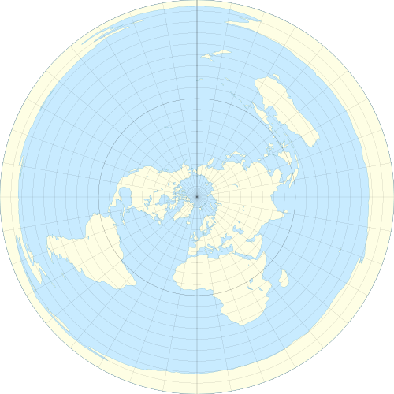

The quaternions were discovered by Hamilton in 1843 when he was trying to figure out how to extend complex numbers to span three dimensions. He realised he needed four dimensions to make it work. He wasn't thinking in terms of matrices, or even vectors. He just created two more special values alongside $1$ and $i$. And 84 years later, Pauli wasn't thinking of quaternions when he followed the rules of QM to come up with his matrices, although others spotted the resemblance immediately.

Before seeing how they work, we'll temporarily jump forwards into what is certainly the most important application of quaternions: rotations in three dimensions, just because it will convey just how much they resonate with our findings about qubits. Check out how a quaternion, $r$, representing a rotation by angle $\theta$ around an axis $\vec{u}$, is built from the component quaternions scaled by the coordinates of the axis, $\vec{u} = (u_x, u_y, u_z)$:

$$
r = \cos \left( \frac{\theta}{2} \right) 
+ \sin \left( \frac{\theta}{2} \right) (u_x \vec{i} + u_y \vec{j} + u_z \vec{k})
$$

Although we haven't looked at it yet, this is basically identical to the formula for making a matrix representing a rotation around such an axis by composing the Pauli matrices. But also:

- Look at how the angles are being halved, exactly like angles in the qubit state space compared with the angles in Bloch/physical space.
- As a result, if you add $2\pi$ to $\theta$, you get $-r$, because the angle is halved, so $\cos$ and $\sin$ only go through half a cycle. You need to add another $360^\circ$ to get back to $r$. This is exactly the same thing that happens with qubits.
- But the quaternions $r$ and $-r$ perform the same rotation, because if the axis is pointing the opposite way *and* you switch from clockwise to anticlockwise rotation at the same time, those two changes cancel out. That is, the two quaternions have the same physical interpretation, which is reminiscent of how quantum states represent the same physical state under a sign flip.
- We'll also see how quaternions have the pleasant symmetry of representing both operations-on-things and things-being-operated-on by the same objects, just like when we use a density operator to represent the state of a qubit.

But the really fun thing about quaternions, I think, is that to get an intuitive understanding of how they model rotations in 3D, we can learn a thing or two from those lovable fools, the flat earthers! In particular, their obsession with a particular projection of the globe onto the plane, called the *azimuthal equidistant projection*. This is map of the earth that appears on the flag of the United Nations, sometimes described as a "view from above", which really doesn't do it justice.

<figure class="tikz">
  
</figure>

Imagine you live on a ball of radius ~6360 km. This shouldn't be too hard, because you do. As you are tiny, less than a ten millionth of that radius, at your local scale the surface of the ball appears to be flat, as long as you don't stare too long at the horizon and notice what happens to tall ships as they disappear from view. So it seems reasonable to make a flat map of the surface with the outlines of all the countries on it, starting from wherever you are and working outwards. The challenge comes from the distortion that occurs as you get further away from your chosen starting point, and there is no one right or best way to deal with this. Every such projection has drawbacks.

Following the example of the UN, we will be northern-hemisphere-centric and put the North Pole at the middle of our map of the world. We'll surround that point with concentric circles representing the circles of constant latitude on the globe. Each is a set of points that are all the same distance (travelling on the surface) from the North Pole. There is an intuitive relationship going on: as the circles we add to our map get larger, so do the circles they represent on the globe.

At some point we'll reach the equator, which is just another circle on our map, but in terms of the relationship between the actual globe and our map, it marks a significant boundary: if we keep going, the concentric circles on our map continue to get larger (they're still getting further from the North Pole) but the corresponding circles of constant latitude on the globe are now getting *smaller*, as they get closer to the South Pole. This has a severe distorting effect on how the southern hemisphere is represented: on the UN flag Australia looks like a sausage.

Finally, when we reach the South Pole itself, the distortion is ridiculous: the South Pole isn't a point on our map. Instead it's the largest outermost circle at the edge, twice the radius of the equator's circle. This is where the flat earthers say that the continent of Antarctica, far from being a landmass that encloses the South Pole, is instead a giant circular wall of ice, which is why [the authorities never allow anyone to visit it](https://adventuresmithexplorations.com/cruises/antarctica/).

<figure class="tikz">
  
</figure>

The things to note here are that we took a ball in 3D space, we ignored everything about that space except for the surface of the ball, which is to say, a sphere, and we poked a hole in the bottom and unwrapped the surface by stretching the hole out to a circle, which is the outermost boundary of a surface with the top of the sphere sitting in the middle. This is possible because a sphere (the surface of a ball) is inherently 2-dimensional, which is why its official name is a *2-sphere*. The points in the 3D space, identified by $(x, y, z)$ coordinates, with $(0, 0, 0)$ being the centre of the ball, include a subset for which:

$$
x^2 + y^2 + z^2 = 1
$$

These are just the points exactly on the unit sphere, nothing inside it (the rest of the ball) and nothing in outer space. So for example, the North Pole has coordinates $(0, 0, 1)$ ($z$ being the north-south axis of the globe), and that's the middle of our UN-style map, so at the middle, the $z$-coordinate is $1$, precisely *because* the other two are zero, so it has to be $1$ to satisfy our formula. Meanwhile all the points on our map that sit on the outer circle, where the South Pole ended up stretched out into the "ice wall", they paradoxically all have the coordinates $(0, 0, -1)$. The equator, meanwhile, is actually a sensible circle on both the actual sphere and on our map, so its coordinates are any points $(x, y, 0)$, where:

$$
x^2 + y^2 = 1
$$

So as we move out from the centre of our map to the outer circle, the $z$ value starts at $1$ (North Pole), goes down to $0$ (equator) and finally reaches $-1$ (South Pole). The other two coordinates are able to vary as points on a circle, making up whatever is left over after $z^2$ has supplied its share of the total that must be $1$.

This means that $x$ and $y$ are the only true coordinates, as you'd expect on a 2D map. If you pin them down, $z$ can only have one of two possible values:

$$
z = \pm \sqrt{1 - (x^2 + y^2)}
$$

So it isn't a free coordinate on our map, and doesn't play any role in how the space of the map operates. It's just a shadow of the 3D space that the actual sphere lives in.

One important scenario to have clear is the journey taken by an airliner if it sets of from the central North Pole and heads toward the South pole (which is to say, in any direction, because all directions lead to the South Pole.) What happens to the airliner as viewed on our map when it reaches the ice wall? It teleports to the opposite side of the circle and then carries on going. This magic trick is of course merely an artefact of how the projection works, unwrapping the southern hemisphere and stretching the pole out into a circle. In reality the airliner just cruises over the South Pole without so much as a glitch, presumably to the great annoyance of any flerfers on board.

Now suppose we replicate this situation but starting with a 4-dimensional space of points $(w, x, y, z)$. We cannot visualise this, which is a problem. But suppose this space contains a 4-ball centred on its origin, whose surface is therefore a 3-sphere (yes, a three-dimensional "surface", just go with it!), which is all the points in the space where:

$$
w^2 + x^2 + y^2 + z^2 = 1
$$

Just as before, by constraining our interest to a subset of the space, we cut the number of dimensions by 1, and thus we have a way to make a map of the 3D "surface" of a 4D ball. And we *can* visualise in 3D, so we're back in business. We just need to make the 3D version of the UN's map of the world, by "flattening" (relatively speaking) that surface into a 3-ball. The circles of the UN map will become spheres in our new map.

This time the $w$ coordinate will be the direction we'll flatten along, and we have a clear reason to treat it as different to the other three. Our four coordinates are the parameters of a general quaternion:

$$
q = w + x\vec{i} + y\vec{j} + z\vec{k}
$$

The $w$ coordinate is the real part. The other three coordinates scale the imaginary units, and we will treat them as orthogonal directions in familiar physical space. Each point within our 3D ball map has a single unit quaternion associated with it. The $w$ coordinate is therefore not an independent unconstrained parameter: it just has to compensate for the other three to bring the total of all their squares to $1$.

Once again we start at the North Pole, now along the $w$ axis, coordinates: $(1, 0, 0, 0)$. Here the other three coordinates must be zero, because $w$ is already contributing $1^2$ to the sum in the constraining formula. We are on top of the world in 4D, but this point sits in the very core of our solid ball-map. In the 3D space map space, if we move to nearby points, then $w$ will have to shrink from $1$ to accommodate the $(x, y, z)$ coordinates taking on non-zero values.

Eventually this exploration of the surrounding space will take us to the equator, which in our solid map is a sphere, and is the set of points where $w$ has fallen to exactly $0$, while the other three coordinates obey:

$$
x^2 + y^2 + z^2 = 1
$$

This is also the boundary between the northern and southern hemispheres of the 3-sphere we're mapping. But of course, as before, as far as our map is concerned, it's just a concentric 2-sphere. We can continue exploring the southern hemisphere, where $w$ falls below zero and eventually reaches $-1$, so the other three coordinates must shrink to accommodate it. At this point, we have a final outermost concentric 2-sphere in our map, the "ice wall", on which every point is the South Pole and has the coordinates $(-1, 0, 0, 0)$.

So, every point inside the ice wall represents a point on the surface of a 3-sphere in 4D quaternion-space. The 3D ball of our solid map can be divided into two parts, an inner core ball, like the Earth's molten iron core, corresponding to points on the northern hemisphere of the actual 3-sphere, where $w > 0$, and an outer shell, like the Earth's mantle, which is the southern hemisphere of the 3-sphere, where $w < 0$.

The points inside our ball-map consists of all the *unit quaternions*:

$$
\vec{q} = w + x\vec{i} + y\vec{j} + z\vec{k}
\quad \quad
w^2 + x^2 + y^2 + z^2 = 1
$$

The real part $w$ is called the scalar and the other three comprise the vector part of the quaternion. It was actually Hamilton who came up with these terms, which were later borrowed when vector spaces were abstracted out of his work.

Now we've constructed our solid United Nations map of all unit quaternions, what are we going to use it for?
